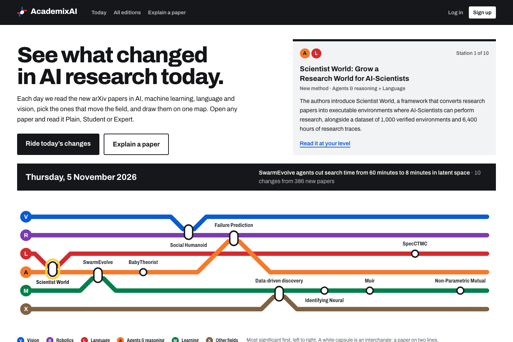
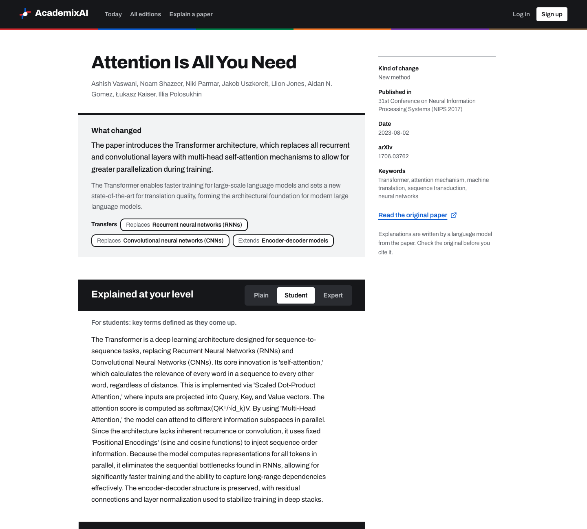

# AcademixAI

[](https://github.com/raghavsarna/AcademixAI/actions/workflows/ci.yml)

**What changed in AI research today, and every paper explained at your level.**

Hundreds of AI papers land on arXiv every day. AcademixAI reads each day's new papers in AI, machine learning, language and vision, picks the ones that actually move the field, and draws them as a metro map: research areas are coloured lines, the day's papers are new stations, and a paper that spans two areas is an interchange. Open any paper and read it at the depth that suits you: **Plain**, **Student** or **Expert**.



## What it does

- **A daily changelog, not a newsletter.** Each edition ranks the ~10 papers that change the field most, and says for each one what it claims is new, what kind of change it is, and which earlier work it extends, challenges or replaces.
- **One paper, three readers.** Every paper is explained three times: for someone who has never read a paper, for a student meeting the idea, and for a practitioner who wants the method and the numbers. Switch depth in place; the choice is kept in the link.
- **Explain your own paper.** Upload a PDF and get the same treatment from its full text. Re-uploading a known paper (same file, DOI or arXiv id) reuses the analysis instead of calling the model again.
- **Chat at your depth.** Ask about an edition or a paper and the answer is pitched at the depth you picked.



## How an edition is made

```
arXiv (cs.AI, cs.LG, cs.CL, cs.CV)  ~400-600 papers a day
        │
        ▼
 Triage (1 model call)       pick the ~10 that change the field most
        │
        ▼
 Analyse (1 call per paper)  what changed · builds on · Plain / Student / Expert
        │
        ▼
 Front matter (1 call)       a specific headline, overview and themes
        │
        ▼
 Postgres / SQLite  ──►  FastAPI  ──►  Next.js line diagram
```

About a dozen model calls a day, so it runs comfortably on Gemini's free tier.

## Stack

| | |
| --- | --- |
| Web | Next.js 16 (App Router, Cache Components), React 19, TypeScript, Tailwind CSS 4 |
| API | FastAPI, Pydantic, SQLAlchemy 2, Alembic, JWT auth (PyJWT + bcrypt), per-user rate limits |
| Data | PostgreSQL in production, SQLite locally |
| AI | Google Gemini 3.1 Flash-Lite via `google-genai`, with free Gemma 4 as the fallback when it is rate limited or overloaded |
| Quality | pytest (SQLite and Postgres), ruff, ESLint, TypeScript, GitHub Actions |

## Run it locally

You need Python 3.12+, Node 20+ and pnpm.

**1. API**

```bash
python -m venv .venv
source .venv/bin/activate          # Windows: .venv\Scripts\activate
pip install -r requirements-dev.txt
cp .env.example .env               # add GEMINI_API_KEY and SECRET_KEY
python -m scripts.seed             # creates the database and loads six real editions
uvicorn app.main:app --reload --port 8000
```

- `GEMINI_API_KEY`: from https://aistudio.google.com/apikey
- `SECRET_KEY`: `python -c "import secrets; print(secrets.token_hex(32))"`

**2. Web**

```bash
cd web
pnpm install
pnpm dev                           # http://localhost:3000
```

The web app calls `/api/...` on its own origin and Next.js forwards those requests to the API (`API_URL`, default `http://127.0.0.1:8000`), so there is no CORS setup.

**3. Make today's edition**

```bash
python -m scripts.generate_edition             # the most recent day on arXiv
python -m scripts.generate_edition --days 5    # backfill the last five weekdays
```

## Tests and checks

```bash
pytest                                         # API:  tests, fake model, no key needed
ruff check app scripts tests migrations/env.py
cd web && pnpm exec eslint src && pnpm exec tsc --noEmit && pnpm build
```

CI runs the API tests on SQLite and on Postgres 17 (including migrations), and lints, type-checks and builds the web app.

## API

Interactive docs at `/docs` when the API is running.

| Method | Path | Auth | Purpose |
| --- | --- | --- | --- |
| GET | `/api/editions` | | Editions, newest first |
| GET | `/api/editions/latest` | | The latest edition with its ranked papers |
| GET | `/api/editions/{date}` | | One day's edition, with previous and next dates |
| POST | `/api/editions/{date}/chat` | ✓ | Ask about an edition (`message`, `level`) |
| POST | `/api/papers` | ✓ | Upload a PDF to be explained |
| GET | `/api/papers` | ✓ | Your uploaded papers |
| GET | `/api/papers/{id}` | | A paper with all three explanations |
| POST | `/api/papers/{id}/chat` | ✓ | Ask about a paper (`message`, `level`) |
| POST | `/api/auth/register`, `/api/auth/token` | | Sign up, log in |
| GET | `/api/auth/me` | ✓ | Current user |

## Project layout

```
app/            FastAPI: routers (auth, editions, papers), services (editions pipeline,
                paper analysis, chat), models, Alembic-managed schema
migrations/     Alembic migrations
scripts/        seed, generate_edition, export_seed, migrate
tests/          pytest suite
web/            Next.js app: src/app (routes), src/components (EditionMap, DepthSwitch, ...)
PRODUCT.md      Product positioning and principles
DESIGN.md       The design system: the transit-map world, tokens and components
```

## Design

The interface was designed with a "transit map" visual language: white signage ground, black signage bands, Archivo set like wayfinding signage, and line colours that never change meaning (Language red, Vision blue, Learning green, Agents orange, Robotics purple). Every text colour pairing meets WCAG AA, the diagram becomes a vertical strip map on phones, and all motion respects reduced-motion settings. See [DESIGN.md](DESIGN.md).

Explanations are written by a language model from each paper's abstract (or full text for uploads). Check the original paper before you cite it.
